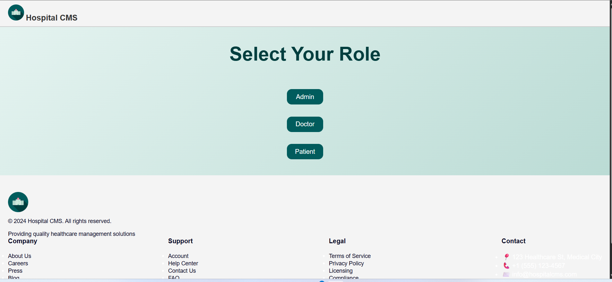

<h1 align="center">Hi, I'm Imad Chakour</h1>

<h3 align="center">Software Engineer | Backend Java &amp; Spring Boot</h3>

OCP Java SE 17 · Oracle Database 19c

Oracle Certified Professional: Java SE 17 Developer. Experienced in building backend applications, REST APIs and microservices using Java and Spring Boot, with hands-on experience in cloud deployment on Oracle Cloud Infrastructure (OCI).

  

  
  

  
  
  

<h2 align="center">Featured Projects</h2>

<table align="center" width="100%">
  <tr>
    <td width="33%" align="center" valign="top">
      
      <h3>Multi-Connector Banking Service</h3>
      
A banking platform with REST, SOAP, GraphQL, and gRPC APIs, built with Spring Boot and React.

      <a href="https://banklink-imad.duckdns.org">Live demo</a> ·
      <a href="https://github.com/imad-chakour/bank-service-multi-connector">Source code</a>
    </td>
    <td width="33%" align="center" valign="top">
      
      <h3>EventFlow</h3>
      
An event and marketing platform built with Angular and Spring Boot.

      <a href="https://eventflow-imad.duckdns.org">Live demo</a> ·
      <a href="https://github.com/imad-chakour/eventflow-angular-springboot">Source code</a>
    </td>
    <td width="33%" align="center" valign="top">
      
      <h3>Smart Clinic</h3>
      
A clinic app for managing patients, doctors, and appointments.

      <a href="https://clinic-imad.duckdns.org">Live demo</a> ·
      <a href="https://github.com/imad-chakour/java-clinic-management-system">Source code</a>
    </td>
  </tr>
</table>

---

Open to building thoughtful software and connecting with fellow developers.

